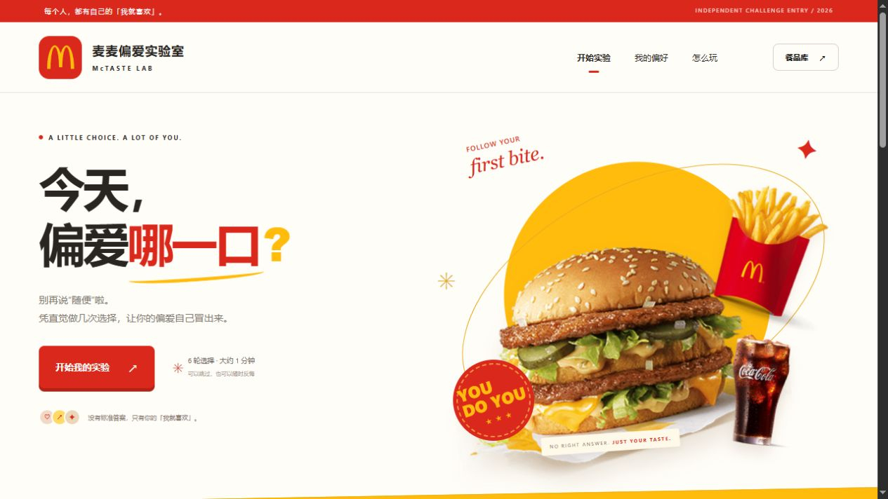

[▶ 观看产品宣传片（1080p · 50 秒）](https://plusf666.github.io/mctaste-lab/docs/mctaste-lab-1080p.mp4)

<div align="center">

# 麦麦偏爱实验室 · McTaste Lab

**今天，偏爱哪一口？**

几轮二选一，让偏爱自己冒出来。

`Agent Skill` · `麦当劳 MCP` · `可解释的偏好实验` · `零第三方运行依赖`

</div>



> 独立参赛作品，非麦当劳官方产品。公开体验集使用来自官网的真实餐品名称与图片，**不是实时门店可售菜单**。本版本的 MCP 采集代码已实现，但尚未配置 Token 完成真实官方联调，尚未报名。参赛前须完成真实调用，详情见 [MCP_INTEGRATION.md](MCP_INTEGRATION.md)。

## 为什么做这个

“随便吃点”不代表你没有偏好，可能只是暂时说不清。麦麦偏爱实验室用看得见的餐品开始：两口之间，跟着直觉选。

最多六轮后，你会得到一份**可以查看依据、随时修改的本轮偏好**。结果不是人格标签，也不是“AI 猜中你”的承诺。你可以撤销、跳过、两个都选、两个都不选；也可以直接拖动倾向条，看推荐跟着变化。

面向不想填问卷、面对菜单容易犹豫的人，也为希望用明确选择而非臆测表达偏好的 Agent 提供可复用 Skill。

## 你可以玩到什么

- **二选一实验**：问题避免重复，优先覆盖尚未观察的类别。可以跳过、撤销或提前看当前结果。
- **看得见的偏好**：牛肉汉堡、鸡肉汉堡、鱼肉汉堡、小食、甜品、饮品六类倾向，与逐轮证据一起呈现。
- **你拥有定义权**：手动调节独立标记，不篡改原始选择，一键恢复。
- **两条推荐路线**：“稳稳心动”来自本轮明确选中的单品；“试点新意”来自同一候选集里本轮尚未选中的单品，不假设你从未吃过。
- **餐品库管理**：暂时排除某个单品，问题和推荐同步遵守。排除不是过敏原筛查。
- **带得走的实验**：导出 SVG 偏好卡、JSON 记录；可在本地恢复完整实验。默认不上传、不自动持久保存。

体验集包含官网公开的 15 个餐品；价格全部为 `null`，不编造门店报价。金拱门标志与产品照片注明来源，原创红黄界面独立实现，视觉素材归原权利人。

## 运行

Python 3.10+；CLI 和测试另需 Node.js 18+。无 npm 安装依赖步骤。

```powershell
python scripts/serve.py
```

打开 `http://127.0.0.1:8766`，或 Windows 双击 `启动实验室.cmd`。请通过 HTTP 运行，不直接双击 `dist/index.html`。

静态托管只需要 `dist/` 内容，支持子路径。主页面无远程运行依赖；餐品图和官方标志已包含在项目中。网页支持桌面与手机，减少动画偏好和键盘操作。

```powershell
node scripts/demo.mjs
node scripts/experiment.mjs docs/DEMO_SESSION.json
```

`DEMO_SESSION.json` 是预设验收样例，不代表用户真实偏好。

## 算法足够简单，也足够透明

每类从中性 50 开始。正向选择累积正证据，明确未选累积反证据：

```text
倾向指数 = round(100 × (1 + 正向证据) / (2 + 正向证据 + 反向证据))
```

“跳过”不更新偏好；同类单品二选一只更新单品，不推断类别。问题排序考虑类别覆盖、餐品曝光、双方当前倾向接近度，且不重复同一对餐品。候选不足则提前结束，不编造候选。

推荐按类别倾向加本轮单品正选择排序，明确拒绝或排除的单品不会进入结果。手动覆盖值只替换类别排序指数。指数不等于真实喜好概率，不是科学心理测评。证据不足就写证据不足，不给用户强行贴标签。

## 安装 Skill 与真实菜单

将 `skills/mctaste-lab` 导入支持 Markdown 技能的宿主。保留完整项目，Skill 会定位共享引擎与 CLI；只复制技能目录时，需要向 Agent 提供项目路径。

通过宿主私密 MCP 设置使用 `mcp-config.example.json`，由宿主解析 `${MCD_MCP_TOKEN}`；若宿主不支持环境变量展开，则在其凭据设置中配置，不能将真实值写回示例。

示例请求：

```text
用麦麦偏爱实验室，帮我选今天想吃的。先让我选门店，每轮只给两个候选。
撤销刚才那轮，我改主意了。
我今天更想吃甜品，把这个倾向调高，再解释推荐怎么变。
```

真实菜单使用 `query-meals`，候选字段与类别按实际响应核对；`query-nearby-stores`、`query-meal-detail` 和 `now-time-info` 为辅助只读工具。采集步骤、字段映射与真实验证状态见 [接入说明](MCP_INTEGRATION.md)。

## 验证与隐私

```powershell
node tests/engine.test.mjs
python -m unittest discover -s tests -p test_*.py
```

当前 22 项算法测试与 12 项采集/协议测试通过。网页和 CLI 共用 `dist/engine.mjs`，没有另写一份演示算法。浏览器验收记录见 [docs/VALIDATION.md](docs/VALIDATION.md)。

Token 不进入浏览器。选择默认只留在当前页面；主动点击“保存在这台设备”后才写本项目的 localStorage 键，清除时不影响其他项目。导出完整 JSON 会包含本次菜单与选择，分享前请自行检查；SVG 偏好卡不包含门店、账号或历史原文。

## 目录

```text
dist/                     界面、共享引擎、官网体验集与素材
scripts/mcp_client.py     只读 Streamable HTTP MCP 客户端
scripts/sync_catalog.py   实时 schema 与菜单采集
scripts/experiment.mjs    Agent 可调用的实验 CLI
skills/mctaste-lab/       技能与记录契约
tests/                    算法、规范化与协议测试
docs/                     素材来源、截图、验收与报名草稿
```

## 参赛与权利说明

官方 `CONTEST_DECLARATION.md` 原样保留。原创代码与布局采用 MIT；官方标志、餐品图及商标不在本项目 MIT 授权范围内，权利仍归原权利人，来源见 [docs/ASSETS.md](docs/ASSETS.md)。

已核对公开报名列表存在同类二选一推荐，因此本项目不宣称概念绝对唯一。本实现重点是用户可编辑的类别证据、单品与类别的区分、可恢复实验记录和两条推荐路线；没有复制其他参赛者代码或页面。

发布到 GitHub 与正式报名是不同步骤。真实 MCP 联调完成后，再依据 [docs/SUBMISSION.md](docs/SUBMISSION.md) 提交报名。
